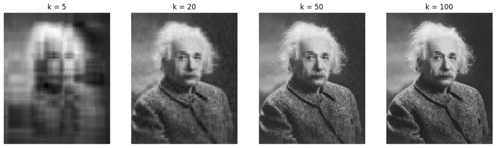

# SVD Image Compression

A short demonstration of how linear algebra powers data compression in AI and machine learning: an image is factorised with **singular value decomposition** and rebuilt from only its top *k* singular values.

Linear Algebra (MATH307) project, Effat University, Spring 2026. Individual work.

> 📄 Case study: [osvr7.github.io/project.html?p=svd-compression](https://osvr7.github.io/project.html?p=svd-compression)



## How it works

A grayscale image is a matrix **A**. SVD factorises it as

**A = U Σ Vᵀ**

where the singular values in **Σ** measure how much each component contributes. Keeping only the first *k* columns of **U**, the top *k* singular values and the first *k* rows of **Vᵀ** gives the best rank-*k* approximation of the image. This low-rank idea is the same one behind PCA and matrix factorisation in ML.

Storing a rank-*k* image takes `k × (rows + cols + 1)` numbers instead of `rows × cols`.

## Results

The script reconstructs the image for **k = 5, 20, 50 and 100** and reports the storage saving for the largest k:

```text
Original size: 549096 numbers
Compressed size (k=100): 149100 numbers
Efficiency: 72.85% reduction
```

At k = 100 the portrait is visually close to the original while storing about a quarter of the numbers.

## Run it

```bash
pip install -r requirements.txt
python svd_compression.py
```

Replace `your_image.jpg` with any image to try your own.

## Tech

Python · NumPy · Matplotlib · Pillow
